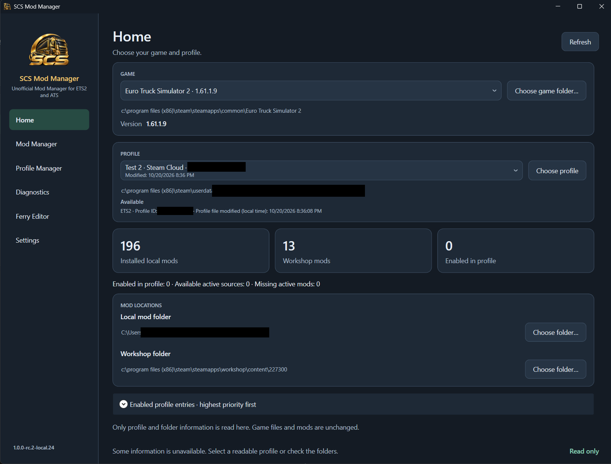
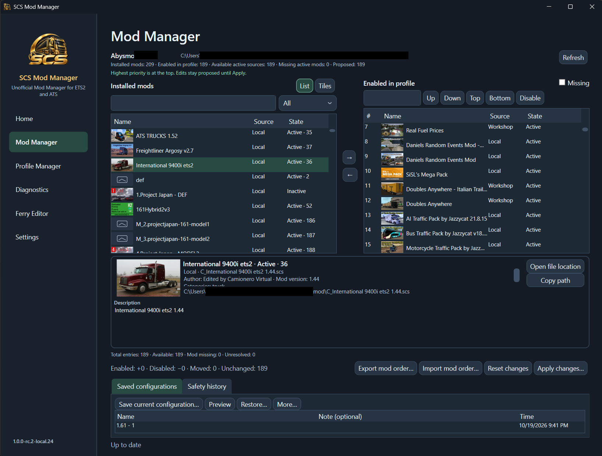
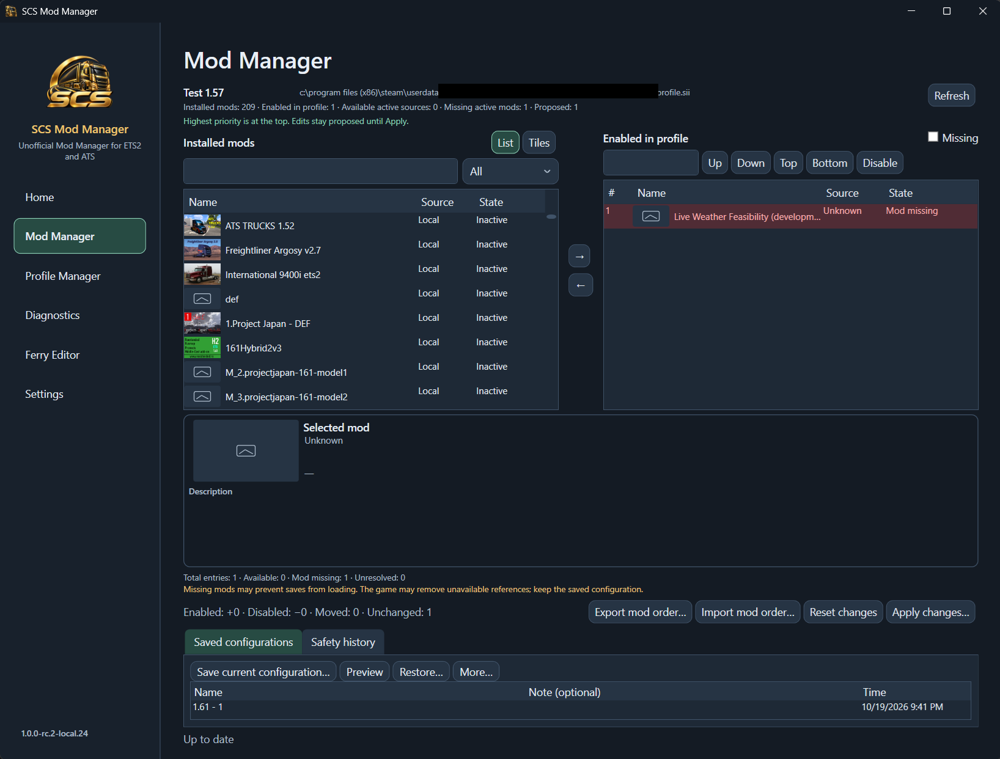
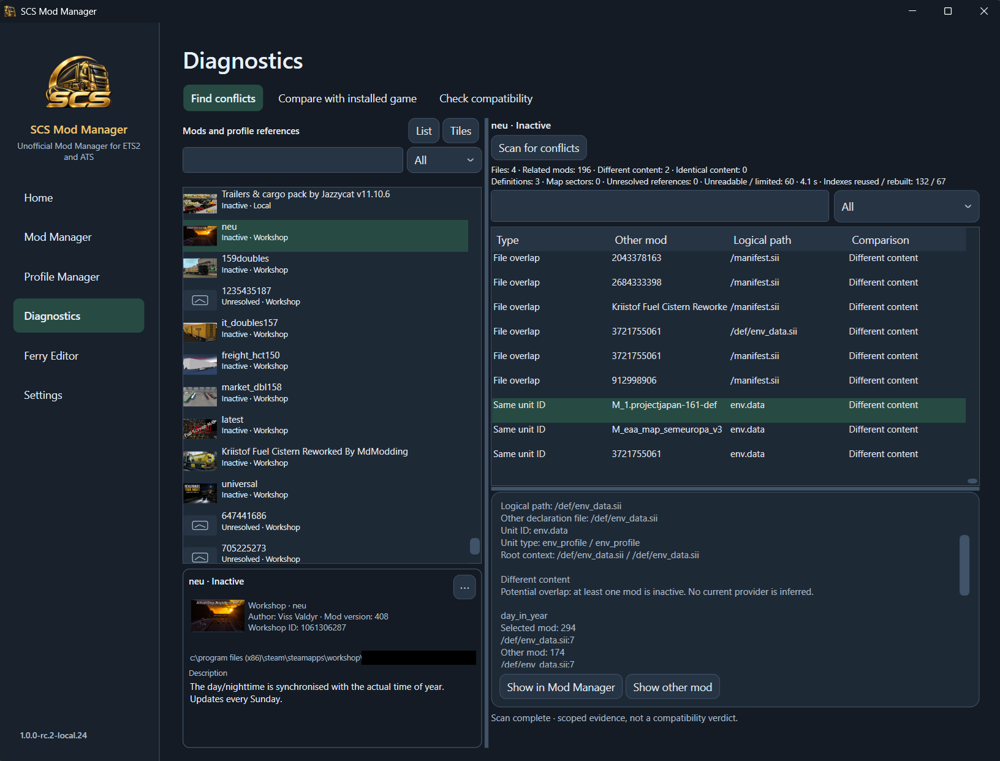
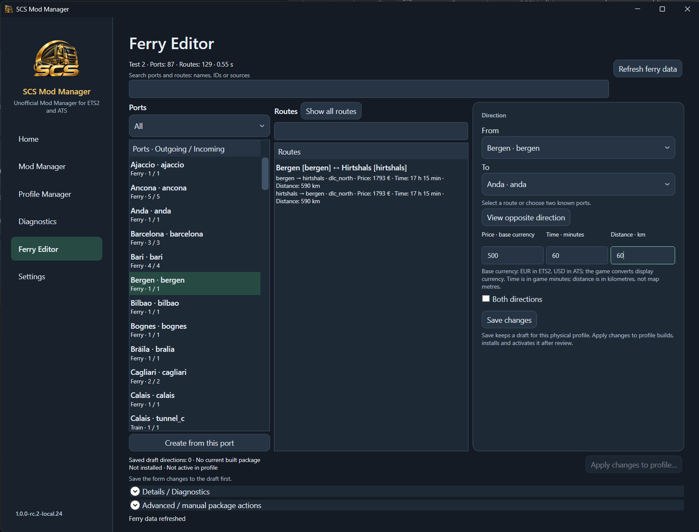
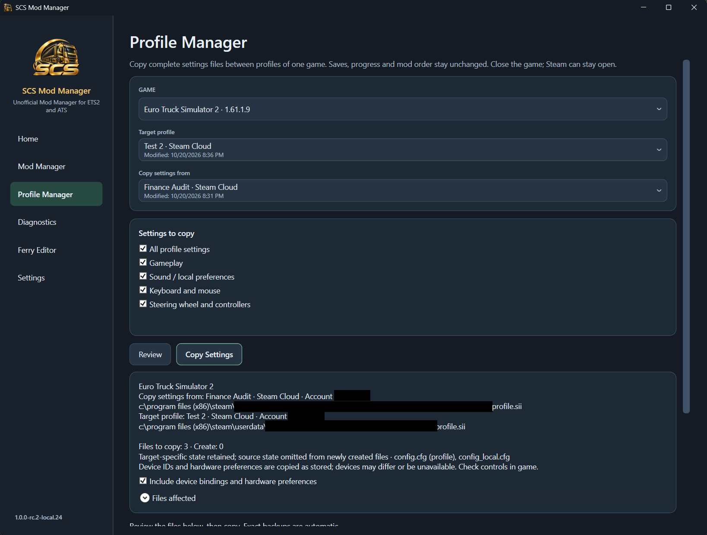

# SCS Mod Manager

Unofficial Mod Manager for ETS2 and ATS, published by **Abysimo** (also known as
**Abysmo** on gaming forums). Freeware, proprietary and closed-source.

SCS Mod Manager is not affiliated with, endorsed or sponsored by SCS Software.
No approval by Valve/Steam or mod authors is implied.

## What it does

- Discover ETS2 and ATS installations and distinguish Local and Steam Cloud profiles.
- Manually manage active mods and exact priority order, including missing entries.
- Save configurations, import/export mod orders and retain guarded profile checkpoints.
- Find file conflicts among selected mods, compare a mod with installed game data
  and export selected original files.
- Check selected mods against the installed game's available resources.
- Edit supported ferry/train connections for the selected profile through separate
  review, patch generation, export/install and activation steps.
- Transfer selected or complete settings between profiles of the same game; keep
  game-wide graphics configuration a separate explicit operation.
- Use List/Tiles, mod descriptions and search, Light/Dark themes and 16 languages.

The application does not automatically determine a correct mod order or repair all
mod conflicts. Opening Home performs discovery; content analysis starts on request.

## v1.0.3 improvements

- Create and install ferry mods from explicitly selected saved directions, with
  exact route/value review and preserved unrelated proposals.
- Acknowledge uncertain compatibility when active map sources are unreadable;
  supported new routes still receive structural package validation.
- Create and install a new unused package while the game runs, leaving it inactive.
  Use Enable mod after closing the game; activation retains exact load-order review,
  backups and recovery. Replacing different existing package bytes requires closure.
- Clear localized Ferry errors beside the workflow. The publisher reports the
  manually exercised local workflow appears to work; wider compatibility is unproven.

See the [v1.0.3 release notes](RELEASE_NOTES_v1.0.3.md).

## Retained v1.0.2 improvements

- Owner-approved Mod Manager layout: mod lists fill the available height, with a
  compact selected-mod information card and a bottom-anchored configuration/history
  panel showing about four to five rows with scrolling.
- One background update check on every normal application startup, without the
  previous persistent cooldown. A prominent notice appears above the workspace.
- Validated known-update notices survive offline restarts. Update and restart,
  Later and Release notes remain available; installation stays under your control.

See the [v1.0.2 release notes](RELEASE_NOTES_v1.0.2.md).

## Retained v1.0.1 improvements

- Recheck Mod Manager proposals after external profile changes while keeping exact
  priorities and missing entries; clearer Apply explanations and roomier saved history.
- Recheck saved Ferry Editor routes without losing values, with more accurate
  source discovery and supported HashFS handling.
- Export a structurally valid new ferry route when some sources cannot be verified,
  after explicitly acknowledging compatibility uncertainty. Expert output is never
  installed or activated automatically; unsafe existing-route edits remain blocked.

The publisher tested one expert-exported Bogorodskoje → Moskalvo Sak route in ETS2
successfully. This is not a guarantee for other routes or map collections.
See the [v1.0.1 release notes](RELEASE_NOTES_v1.0.1.md).

## Screenshots

These English/Dark screenshots show **1.0.0-rc.2-local.24**, captured before the
stable version. Identifying details are visibly redacted; the actual UI and results
are preserved. The displayed mod collection is an example, not a recommended pack.
[Captions, provenance and image review](SCREENSHOTS.md).

### Game and profile overview

This view includes an unavailable-information warning; it is not an all-clear
validation of the displayed installation or sources.

### Installed mods and manual priorities

### Missing references stay visible

### Inspect a specific conflict

This result includes unreadable/limited sources and an inactive selected mod;
potential overlap is not a current priority verdict or a complete compatibility check.

### Ferry routes and their values

The listed Bergen–Hirtshals route and the unsaved Bergen→Anda form are different.
The form's 500 / 60 minutes / 60 km values are proposed inputs, not an installed route.

### Review a settings transfer

The review and device-binding option are shown; the image does not prove that a
copy completed or that all controller/gameplay scenarios were verified.

## Games and languages

ETS2 and ATS have separate game/profile contexts, local mod folders and Workshop
AppIDs. Local and native Steam Cloud profiles are supported; cloud data must resolve
to the correct physical profile rather than merely a same-named local copy.

Development and verification have used **ETS2 1.61** and **ATS 1.61** installations.
Coverage varies by game and operation; no universal version/mod-pack compatibility
is promised. The screenshots identify the actual installed ETS2 build.

Languages: English, Russian, Turkish, Portuguese (Brazil), Polish, Chinese
(Simplified), Spanish (Spain), German, French, Czech, Korean, Ukrainian, Romanian,
Dutch, Italian and Spanish (Latin America). Translation coverage does not imply
native-speaker review of every phrase.

## Requirements

- A supported **Windows x64** installation for .NET 10/WPF. Check Microsoft's
  [Windows support requirements](https://learn.microsoft.com/en-us/dotnet/core/install/windows).
- A local installation of **Euro Truck Simulator 2**, **American Truck Simulator**,
  or both, and lawful access to the game/mod data you choose to use.
- A writable folder for the portable application, user application data and backups;
  enough free space for extracted runtime libraries, checkpoints and staged updates.
- Internet access for GitHub update checks/downloads and public support. Local
  management tools do not require an application account or telemetry connection.

.NET 10 and WPF are bundled. Visual Studio, the .NET SDK and a separate .NET runtime
installation are not required. No game, DLC or mod archive is included.

## Installation and portable use

1. Obtain the official Windows x64 portable ZIP and checksums from
   [GitHub Releases](https://github.com/Abysimo/SCSModManager-Releases/releases).
2. Extract the complete archive into its own writable folder. Keep the notices and
   `licenses/` directory alongside `SCSModManager.exe`.
3. Double-click **SCSModManager.exe**. No installer or administrator elevation is required.
4. Select the intended game and exact profile. Check its storage/location and review
   proposed changes before applying them. Keep independent backups of valuable data.

The portable root contains the EXE, `THIRD_PARTY_NOTICES.txt` and `licenses/`.
Bundled native .NET/WPF libraries may extract to Windows' temporary bundle cache.
Preferences, caches and safety records are stored separately under Windows
LocalApplicationData, normally `%LOCALAPPDATA%\SCSModManager`. Moving/removing the
portable folder does not remove that user data. Preserve failed-update recovery
files until recovery is resolved.

Close the corresponding game before profile writes. Steam may remain running;
actual concurrent file changes or unavailable data can still cause a safe refusal.
Steam controls subsequent Cloud synchronization. Profiles with identical names
are not assumed to contain identical data. ETS2 and ATS remain separate.

## Updates

Official stable builds use the pinned identity of
[Abysimo/SCSModManager-Releases](https://github.com/Abysimo/SCSModManager-Releases).
Starting with v1.0.2, each normal launch checks once in the background, without a
persistent normal cooldown or periodic polling. Navigation does not repeat the
check. GitHub-requested rate-limit waits are respected; manual checks remain
available. Validated cached notices can survive temporary network failures.
Checks do not download or install updates.
**Update and restart** requires your action and uses verified assets, hashes,
safe staging, backups and recovery. Pending edits can prevent restart.

Only newer stable versions qualify. Local development builds cannot check or
install updates. The application sends no profile/mod contents or diagnostic logs
in its update requests and contains no GitHub authentication token.

## Known limitations

- Windows x64 portable only. Compatibility depends on game version, mod format,
  accessibility and available definitions; a diagnostic result is not a guarantee
  that every mod combination works.
- Unsupported, protected, corrupt or inaccessible sources may have incomplete or
  unavailable results. Missing mods are not downloaded automatically.
- Cloud sync, game changes, hardware/device settings and unusual installations
  require appropriate user checks. Automated tests are not second-PC acceptance.
- Updates require a writable, separate portable folder; mixed/reparse installations
  may be refused. Retain recovery evidence after an interrupted update.

## Support and bug reports

- [Discussions](https://github.com/Abysimo/SCSModManager-Releases/discussions):
  Questions & Support, Ideas & Suggestions, and permission requests.
- [Issues](https://github.com/Abysimo/SCSModManager-Releases/issues): reproducible
  bugs. Include application/game versions, reproduction steps and expected/actual
  behavior. Remove personal information from screenshots and diagnostic details.

These are public channels. Do not post raw profiles, saves, checkpoints or detailed
logs without reviewing their contents. The app does not automatically upload them.

## License and notices

Freeware and closed-source: free application use, official release links,
byte-identical complete original archive distribution through P2P, and reviews,
screenshots, tutorials and videos are permitted under the accompanying terms.
Unauthorized modification/derivative redistribution, repackaging, third-party
hosting/mirrors, application resale and proprietary source redistribution are
restricted. Mandatory law and independently licensed third-party rights prevail.
See [LICENSE](LICENSE.txt), [EULA](EULA.txt), [privacy/data handling](PRIVACY.md),
[unofficial software notice](UNOFFICIAL.md) and
[third-party notices](THIRD_PARTY_NOTICES.txt). Keep the complete notices and
`licenses/` directory with the portable application.
